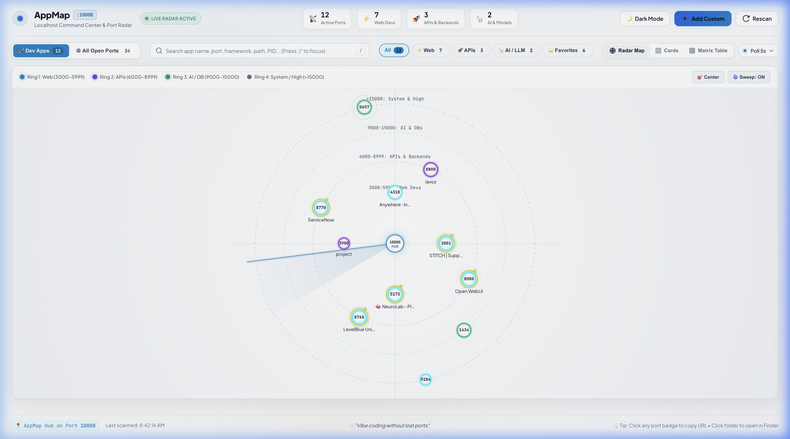
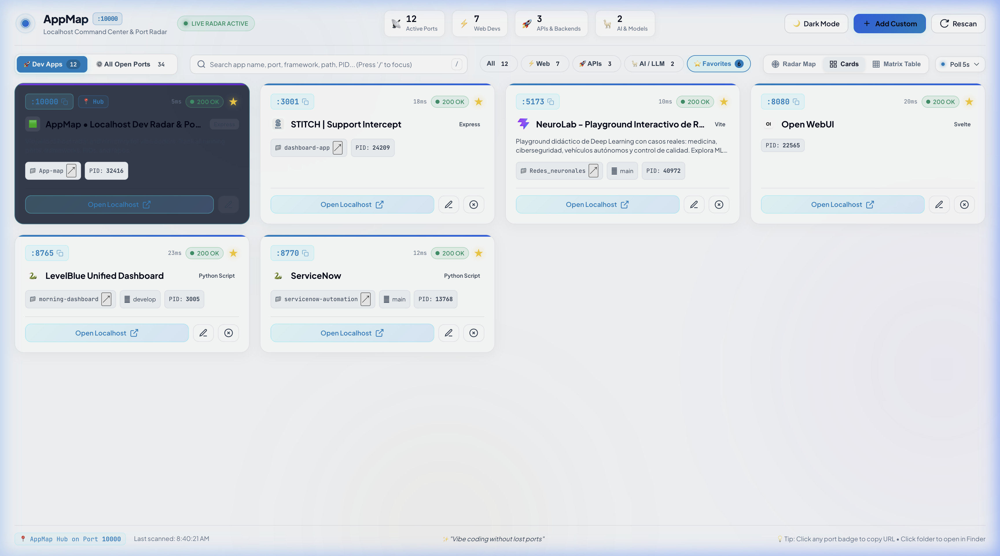
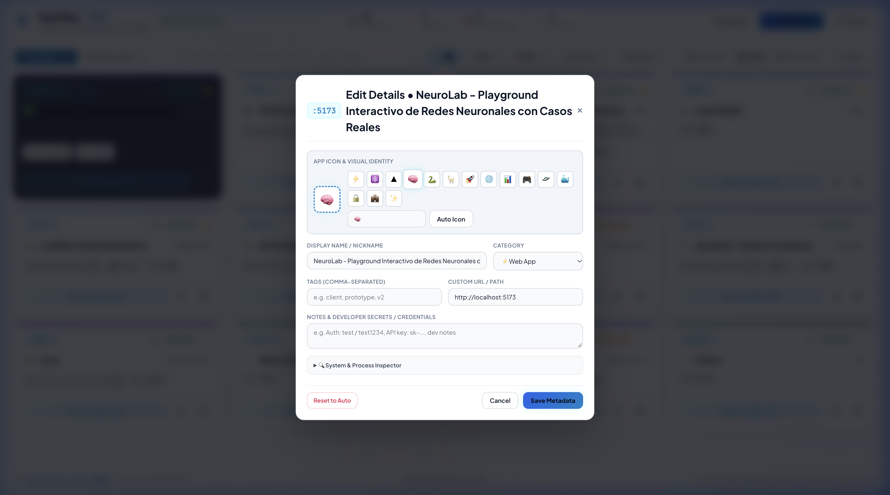
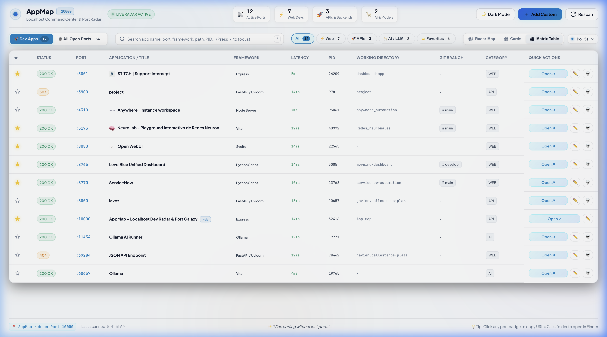

# 🌐 AppMap • Localhost Command Center & Port Radar

> **Stop the localhost chaos. Find every running app instantly.**  
> The ultimate visual command center designed for modern multi-project development and vibe coding — never lose track of a dev port again.

[](https://github.com/javierb507/AppMap/releases/tag/v1.0.1)
[](#-platform-support)
[](https://nodejs.org)
[](LICENSE)

---

## 🤯 The Problem: Localhost Madness

Ever had a development session that looked like this?
- You have **6 terminal tabs** open running Vite, Next.js, FastAPI, Ollama, Docker, and Python scripts.
- Vite silently moved from `5173` to `5174` because another instance was still running in a background tmux or terminal tab.
- You can't remember if your microservice was on `:3001`, `:4310`, or `:8765`.
- A zombie node process is holding a port, forcing you to type `lsof -i :3000 | awk '{print $2}' | xargs kill -9` for the 10th time today.
- You have no idea which physical folder or git branch is powering the server on `:8080`.

**This friction breaks your flow.**

---

## 🚀 The Solution: Total Visual Control

**AppMap** turns your invisible localhost into a living, interactive radar galaxy:

- 🔍 **Instant X-Ray Discovery**: Scans and identifies every active TCP listener, process name, PID, HTTP status, and response latency in sub-50ms without external agents.
- 📁 **Repository & Git Context**: Automatically tracks which physical folder on disk (`cwd`) and Git branch (`main`, `feature/auth`) spawned each server.
- 🔄 **Smart Port-Shift Tracking**: When an app jumps ports (e.g. `5173 → 5174`), AppMap recognizes its fingerprint and seamlessly moves your notes, tags, and favorites with it.
- 🌟 **Star Your Daily Drivers**: Pin key apps as favorites with glowing celestial halos on the radar and dedicated 1-click filtering.
- 🛠️ **1-Click Actions**: Open apps in browser, reveal project folders in Finder/Explorer, and gracefully terminate zombie processes with one click.
- 🌍 **True Multiplatform**: Zero native dependencies — runs identically on **macOS**, **Linux**, and **Windows** on fixed port **`http://localhost:10000`**.

---

## 📸 Screenshots & Visual Showcase

### 🌌 Radar Galaxy View
*Real-time orbital canvas mapping local services by port bands, featuring rotating radar sweep, live latency pings, star halos for favorites, and laser targeting inspection.*



---

### ⭐ Developer Cards & Favorites Filter
*Glassmorphic cards with responsive latency badges, framework chips, project paths, 1-click launch, and reactive star pinning with dedicated Favorites isolation.*



---

### 🎨 App Icon & Visual Identity Picker
*Custom visual identity manager with 1-click emoji palette, custom image/SVG URLs, live icon preview, and automatic disk/web favicon detection.*



---

### 📊 Matrix Inspector Table
*High-density developer table with sortable columns, live status codes, millisecond latencies, working directories, active Git branches, and inline process actions.*



---

## ✨ Features

- 📡 **Automated Localhost Port Discovery**:
  - Automatically discovers all listening TCP ports on macOS, Linux and Windows (see [Platform support](#-platform-support)).
  - Identifies Process Name, Process ID (PID), command-line arguments, and working directory (`cwd`).
  - Detects Git repository folder name and active Git branch (e.g. `main`, `develop`).
  - Probes HTTP services for status code (`200 OK`, `307`, `404`), HTML `<title>`, `<meta description>`, latency (`ms`), and favicon.
  - Automatically identifies frameworks: **Vite**, **Next.js**, **React**, **FastAPI / Uvicorn**, **Flask**, **Django**, **Ollama**, **Svelte**, **Astro**, **Vue**, **Angular**, **Express**, **Docker**, etc.
  - Categorizes servers into:
    - ⚡ **Web Apps** (Vite, Next.js, React dev servers)
    - 🚀 **APIs & Backends** (FastAPI, Flask, Express, Uvicorn)
    - 🦙 **AI & Local LLMs** (Ollama, PyTorch, LangChain)
    - 💾 **Databases & Caches** (PostgreSQL, Redis, MongoDB)
    - 🖥️ **System & Desktop Services**

- 🌌 **Three Interactive Views**:
  1. **Radar Galaxy Map**:
     - Visual orbital canvas centered at `Localhost:10000`.
     - 4 concentric orbital rings categorized by port range (Web Devs, APIs, AI/DB, System).
     - Live rotating sweep beam, pulsating status halos, and laser targeting beams.
     - Hover over any node to reveal instant preview card; click to inspect or launch.
  2. **Developer Cards Grid**:
     - Modern glassmorphic cards with responsive latency badges and status chips.
     - 1-click copy for `http://localhost:<port>` and working directory path.
     - Direct button to open folder in **Finder / Explorer / your Linux file manager**.
     - Launch button to open application in browser with one click.
  3. **Matrix Inspector Table**:
     - Dense tabular view with sortable columns (Port, Status, Name, Framework, Latency, PID, Working Directory, Git Branch, Category).
     - Quick inline action buttons.

- ✏️ **Custom User Metadata & Notes**:
  - Rename any detected app with a custom display name / nickname.
  - Assign custom categories and tags (e.g. `#client-demo`, `#prototype`, `#vibe-session`).
  - Add developer notes and test credentials (e.g. `admin / test1234`).
  - Star / Pin favorite applications.
  - Add manual ports (for Docker containers, ngrok / cloudflare tunnels, WSL, or external dev servers).
  - All annotations persist in `app-map-data.json`.

- ⚡ **Live Real-time SSE Sync**:
  - Live Server-Sent Events (`/api/events`) connection updates the radar in real time whenever a server starts or stops in terminal.
  - Toast alerts notify when a new dev server appears on localhost.

- 🔄 **Port-Shift Detection**:
  - Apps are fingerprinted by `package.json` name → project folder → page `<title>` → command line.
  - When a dev server hops ports (e.g. Vite `5173 → 5174`), nickname, notes, icon and favorite follow it, and the UI flags the shift.

- 🎨 **App Icons**:
  - Auto-detected from the page (`<link rel="icon">`, data URIs) or from the project folder (`public/favicon.svg`, `logo.png`, …).
  - Override with any emoji or image URL from the Edit dialog.

- 🛡️ **Safe Process Termination**:
  - Kill hung or runaway dev servers directly from the UI with modal confirmation.
  - Choice between graceful `SIGTERM` and immediate force kill `SIGKILL` (`taskkill /T` and `taskkill /T /F` on Windows).
  - Safeguards protect the AppMap hub itself from accidental termination.

---

## 🚀 Quick Start

```bash
git clone https://github.com/javierb507/AppMap.git
cd AppMap
npm install
npm start          # or: npm run dev (auto-restart on changes)
```

Open your browser at:
👉 **[http://localhost:10000](http://localhost:10000)**

Use another port with `PORT=12000 npm start` (macOS/Linux) or `$env:PORT=12000; npm start` (PowerShell).

---

## 💻 Platform Support

All OS-specific logic lives in [`lib/platform.js`](lib/platform.js). Each step degrades gracefully if a tool is missing.

| Capability | macOS | Linux | Windows |
|---|---|---|---|
| Listening ports | `lsof -iTCP -sTCP:LISTEN` | `ss -ltnp` (fallback `lsof`) | `Get-NetTCPConnection` (fallback `netstat -ano`) |
| Command line | `ps -ww -eo pid,args` | `/proc/<pid>/cmdline` | `Get-CimInstance Win32_Process` |
| Working directory | `lsof -d cwd` | `/proc/<pid>/cwd` | Inferred from script paths in the command line |
| Open URL | `open` | `xdg-open` / `gio open` | `rundll32 url.dll` |
| Open folder | Finder | `xdg-open` | Explorer |
| Kill process | `SIGTERM` / `SIGKILL` | `SIGTERM` / `SIGKILL` | `taskkill /T` / `taskkill /T /F` |

**Notes**
- **Linux**: process names/PIDs of *other users'* sockets are only visible when running as root; your own dev servers are always detected. Install `iproute2` (`ss`) or `lsof`.
- **Windows**: requires PowerShell 5+ (built in on Windows 10/11). Windows doesn't expose another process' working directory, so AppMap infers the project folder from script paths (e.g. `node C:\work\shop\node_modules\vite\bin\vite.js` → `C:\work\shop`). Apps started as bare `node server.js` may show no folder.
- **WSL**: run AppMap inside WSL to see WSL servers (Linux mode), or on Windows to see Windows servers.

---

## 🛠️ Tech Stack

- **Backend**: Node.js ≥ 18, Express 5, native OS tooling via [`lib/platform.js`](lib/platform.js).
- **Frontend**: Modern Vanilla JavaScript, HTML5 Canvas, Vanilla CSS3 (Glassmorphism, CSS Custom Properties, native `<dialog>` modals with backdrop filters).
- **Zero Heavy Framework Overhead**: Sub-second load times, sub-50ms scans, zero bundler latency.

---

## 📁 Project Structure

```
App-map/
├── package.json          # Project metadata and start scripts (v1.0.0)
├── server.js             # Express 5 server listening on port 10000 & SSE stream
├── app-map-data.json     # Local store (git-ignored): tags, nicknames, notes, favorites
├── docs/
│   └── images/           # High-resolution screenshots for GitHub & Gitea
├── lib/
│   ├── platform.js       # Cross-platform layer (macOS, Linux, Windows)
│   ├── scanner.js        # Port scanner, fingerprinting, git info, categorizer
│   ├── prober.js         # HTTP/TCP latency prober, framework and favicon detector
│   ├── store.js          # Persistent JSON store manager (port-shift & favorites)
│   └── actions.js        # Process killer, open in browser / file manager
├── test/
│   └── platform.test.js  # Automated cross-platform test suite
└── public/
    ├── index.html        # Main dashboard SPA
    ├── css/
    │   ├── main.css      # Core tokens, dark cyberpunk theme, ambient glows, header
    │   ├── radar.css     # Orbital radar canvas and tooltip styles
    │   └── components.css# Cards grid, matrix table, dialog modals, toasts
    └── js/
        ├── app.js        # State manager, reactive favorites, and SSE live listener
        ├── radar.js      # Interactive HTML5 Canvas radar galaxy with star halos
        ├── cards.js      # Developer cards grid renderer with port-shift badges
        ├── table.js      # Matrix table inspector renderer
        ├── modal.js      # Edit metadata, custom emoji palette & process kill dialogs
        └── ui.js         # Search, category filters, keyboard shortcuts ('/'), toasts
```

---

## 🏷️ Release Notes (v1.0.0)

**Initial Official Release** — The visual localhost command center for developers:
- 🌌 **Radar Galaxy Canvas**: Orbital visualization of localhost services with live radar sweep and status halos.
- 💻 **Full Cross-Platform Support**: Works seamlessly on **macOS**, **Linux** and **Windows** without native binary dependencies.
- 🔄 **Port-Shift Detection**: Resilient application fingerprinting that preserves your notes, tags, custom icons, and favorite status when dev servers change ports.
- ⭐ **Reactive Favorites System**: Instant star toggling with dedicated filter tab and golden radar halos.
- 🎨 **Visual Identity & Icon Customization**: Auto-extraction of favicons and inline SVG data URIs, local disk asset serving (`/api/app-icon/:port`), plus an interactive 1-click emoji palette.
- ⚡ **Real-Time Live SSE**: Zero-refresh instant synchronization across multiple browser windows.
- 🛡️ **Graceful & Force Process Termination**: Stop stuck dev servers directly from the dashboard.
